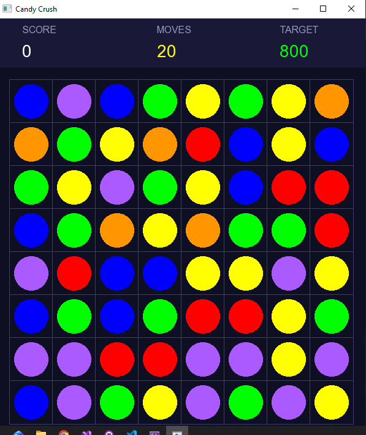

names: Abdul Haseeb and Muhammad Ammar Farooq
Roll numbers : 26L-0047 and 26L-0033
controls: use arrow keys to move the cursor up and down to select game mode(new game, continue game, and exit). press enter to open your choice or close the game.use cursor to select and swap bubbles.press esc to save the game.
how the game runs: Clone the repository and open the project in Visual Studio (configured with SFML 3.0.2).
Make sure 'level.txt' and 'arial.ttf' are placed in the working/project directory.
Build and run the project (e.g., in x86 / Release or Debug mode

